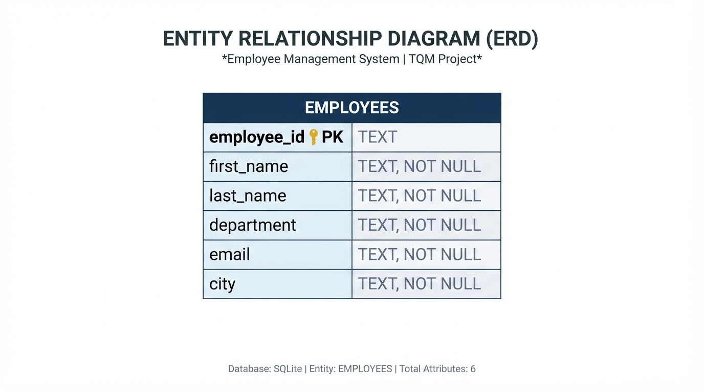
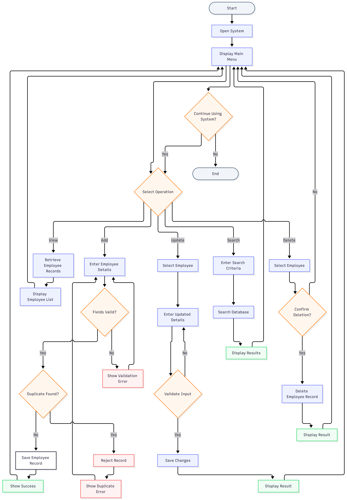

# Employee Management System — Quality Goal Q06

**Course:** BBAT104 — Total Quality Management (TQM)
**Author / Student ID:** Riya Mehta (AU-24-5368)
**Quality Goal:** Q06 — Reduce Duplicate Entries

---

## 1. Project Overview & TQM Context

The **Employee Management System (EMS)** is an academic software solution developed for the **BBAT104 Total Quality Management** curriculum. Its primary objective is to maintain reliable, accurate, and organized personnel records while preventing dirty, redundant, or inconsistent employee entries.

In data quality engineering, duplicate records are categorized as **input-stage defects**. Such defects lead to inaccurate headcount reporting, payroll errors, split performance records, and administrative rework.

Under TQM principles, quality cannot be merely inspected into a system after defects occur; it must be designed into the process through **Poka-Yoke (mistake-proofing)**. This project embeds multi-tier defect prevention directly into the application and relational database layers, intercepting duplicate records before they can enter persistent storage.

---

## 2. Core Architecture: Shared Database Engine

The system provides **two distinct interfaces** operating concurrently against a **single shared SQLite database** (`employees.db`):

1. **Desktop GUI Application (`src/main.py`):** Built with Python's standard `tkinter` and `ttk` library.
2. **Modern Web Application (`app.py`):** Built with `Flask`, Jinja2 HTML templates, custom CSS, and responsive `Bootstrap 5`.

Both interfaces import and reuse the exact same backend CRUD and integrity logic in `src/database.py`. Any employee added, updated, or deleted in one interface is immediately reflected in the other with zero synchronization lag or data fragmentation.

```
                     ┌───────────────────────────────┐
                     │          User Client          │
                     └───────┬───────────────┬───────┘
                             │               │
               Desktop Input │               │ Web Browser Input
                             ▼               ▼
         ┌───────────────────────┐       ┌───────────────────────┐
         │  Tkinter Desktop App  │       │   Flask Web App       │
         │     (src/main.py)     │       │      (app.py)         │
         └───────────┬───────────┘       └───────────┬───────────┘
                     │                               │
                     │   Calls Shared Python API     │
                     └───────────────┬───────────────┘
                                     │
                                     ▼
                    ┌─────────────────────────────────┐
                    │      Backend Relational Layer   │
                    │        (src/database.py)        │
                    │   • Parameterized SQL CRUD      │
                    │   • IntegrityError Translation  │
                    │   • Context Manager Connections │
                    └────────────────┬────────────────┘
                                     │
                                     ▼
                    ┌─────────────────────────────────┐
                    │      SQLite Database File       │
                    │        (employees.db)           │
                    │   • PRIMARY KEY COLLATE NOCASE  │
                    │   • UNIQUE COLLATE NOCASE       │
                    │   • Case-Insensitive B-Tree Idx │
                    └─────────────────────────────────┘
```

---

## 3. Quality Goal Q06: Duplicate Prevention Mechanisms

The system employs a multi-tiered Poka-Yoke defense strategy to enforce data uniqueness:

1. **Case-Insensitive Identifier Uniqueness:**
   * Employee IDs are declared `TEXT PRIMARY KEY COLLATE NOCASE`. Lookups and collisions treat `E101` and `e101` as identical.
2. **Case-Insensitive Email Uniqueness:**
   * Email addresses are declared `TEXT NOT NULL UNIQUE COLLATE NOCASE`. Re-registering `alice@example.com` as `ALICE@EXAMPLE.COM` is blocked.
3. **Form Key Locking on Update:**
   * When an employee record is opened for modification, the `Employee ID` is locked (`state="disabled"` in Tkinter; `readonly` attribute in Flask). This prevents primary key alteration and prevents operators from creating accidental duplicates during edits.
4. **Pre-Add Existence Validation:**
   * Before displaying confirmation dialogs, the system checks whether the identifier already exists, preventing needless operator prompts.
5. **Syntax and Mandatory Field Validation:**
   * Blank values are rejected. Email format is verified against standard regex syntax (`r"[^@\s]+@[^@\s]+\.[^@\s]+"`) on both desktop and web interfaces.
6. **Explicit Confirmation Prompts:**
   * Modal confirmation dialogs prevent double-click duplicate form submissions during additions, edits, and deletions.

---

## 4. Technologies Used

* **Core Language:** Python 3 (verified on Python 3.14.6 64-bit)
* **Database Engine:** SQLite 3 (embedded relational storage with B-tree indexes)
* **Desktop Interface:** Python `tkinter` & `ttk` (standard library)
* **Web Framework:** Flask (v3.1.3+)
* **Templating & UI:** Jinja2, HTML5, Custom CSS (`static/css/style.css`), Bootstrap 5.3.3 (via CDN), Bootstrap Icons 1.11.3
* **Test Automation:** Python standard library `unittest` (29 automated tests across database and web routes)
* **Version Control:** Git, GitHub

---

## 5. Setup & Installation

### Prerequisites
* Python 3.10+ installed on your system.
* Pip package manager.

### Step 1: Clone the Repository
```powershell
git clone https://github.com/riyam/BBAT104_TQM_AU-24-5368.git
cd BBAT104_TQM_AU-24-5368
```

### Step 2: Install Web Dependencies
```powershell
pip install -r requirements.txt
```
*(Note: Flask is the sole external dependency; all other desktop and database libraries are built into Python's standard library).*

---

## 6. How to Run the Applications

### Option A: Launch the Flask Web Application
To start the modern responsive web interface:

```powershell
python app.py
```

Open your browser and navigate to:
👉 **`http://127.0.0.1:5000`**

**Web Application Capabilities:**
* Real-time KPI summary cards (Total Employees, Active Departments, Q06 Status).
* Search and filter bar across all employee fields with an instant clear button.
* Responsive employee data table with department badges.
* Add Employee form with floating labels and live client-side validation.
* Edit Employee form with locked immutable `Employee ID`.
* Poka-Yoke confirmation modal popups for additions, updates, and deletions.

---

### Option B: Launch the Tkinter Desktop Application
To start the original desktop GUI interface:

```powershell
python -m src.main
```

**Desktop Application Capabilities:**
* Two-tier interactive desktop layout (1050x650 window).
* Form inputs with automatic field clearing and status bar notifications.
* Interactive Treeview table with row selection listener (`<<TreeviewSelect>>`).
* Form locking disabling the Employee ID text box upon row selection.
* Modal `messagebox.askyesno` confirmation dialogs for Add, Update, and Delete.

---

## 7. Running the Automated Test Suite

All automated tests use isolated temporary SQLite databases (`tempfile.TemporaryDirectory()`). Running tests will **never** alter or delete existing data in `employees.db`.

To run the complete test suite (all 29 tests):
```powershell
python -m unittest discover -s tests -v
```

To run individual test modules:
```powershell
# Run backend database unit tests (15 tests)
python -m unittest -v tests/test_database.py

# Run web application route tests (14 tests)
python -m unittest -v tests/test_web.py
```

---

## 8. Security & Academic Prototype Boundaries

* **CSRF Protection Notice:** The current web interface uses standard HTML forms and HTTP POST requests for modifications and deletions. While suitable for local academic evaluation, Cross-Site Request Forgery (CSRF) protection (e.g., via `Flask-WTF` tokens) is not currently implemented and would be required prior to public multi-user deployment.
* **Database Concurrency:** SQLite uses file-level locking during write transactions. The application uses fine-grained context managers (`with database_connection:`) that open and close connections immediately per query, ensuring safety for single-user and demonstration environments.

---

## 9. Project Documentation Links

Comprehensive engineering documentation is maintained in the `doc/` directory:

* [`doc/srs.md`](doc/srs.md): Formal Software Requirements Specification (Functional requirements FR-01 through FR-14, Non-functional requirements, Poka-Yoke rules).
* [`doc/system-architecture.md`](doc/system-architecture.md): Visual Mermaid architectural flowcharts, tiered defense layers, component matrices, and algorithmic complexity analysis ($O(\log N)$ vs $O(N)$).
* [`doc/test-report.md`](doc/test-report.md): Formal Test Execution Report documenting all 29 automated test cases (TC-01 through TC-29), environments, inputs, and results.
* [`doc/defect-and-root-cause.md`](doc/defect-and-root-cause.md): Quality engineering defect analysis, 5-Whys root-cause investigation, and corrective action matrix for Quality Goal Q06.

## 10. Entity Relationship Diagram (ERD)



## 11. Project Evidence

The following evidence supports Quality Goal Q06 — Reduce Duplicate Entries.

- [KPI Evidence](doc/evidence/kpi-evidence.md)
- [Dashboard Screenshot](doc/evidence/01-dashboard.png)
- [Add Employee Screenshot](doc/evidence/02-add-employee.png)
- [Search Results Screenshot](doc/evidence/03-search-results.png)
- [Edit Employee Screenshot](doc/evidence/04-edit-employee.png)
- [Duplicate Prevention Screenshot](doc/evidence/05-duplicate-prevention.png)

## 12. Process Flow Diagram

