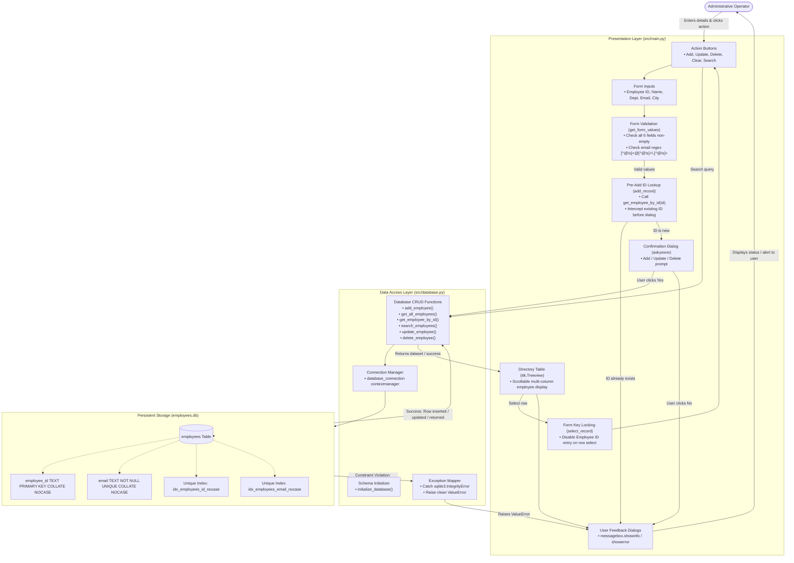

# System Architecture and Flowchart
## Employee Management System — Q06: Reduce Duplicate Entries

- **Course:** BBAT104 — Total Quality Management (TQM)
- **Quality Objective:** Q06 — Reduce Duplicate Entries
- **Author / Student ID:** Riya Mehta (AU-24-5368)
- **Document Version:** 1.0 (Review 1 Deliverable)
- **Document Path:** `doc/system-architecture.md`
- **Related Documents:** `doc/srs.md`, `doc/test-report.md`, `doc/defect-and-root-cause.md`

---

## 1. Architectural Overview

The Employee Management System (EMS) is organized as a lightweight two-tier desktop architecture designed for local deployment. The system decouples user presentation from data persistence, connecting them via clean Python function interfaces:

1. **Presentation Layer (`src/main.py`):**
   * Built using Python's standard `tkinter` and `ttk` desktop GUI widgets.
   * Manages user interactions, form input rendering, table view generation, and modal popup dialogs.
   * Performs client-side validation (non-empty field verification and email regex checking).
   * Implements workflow mistake-proofing (Poka-Yoke), including pre-add ID lookup, selection-based ID locking, and explicit user confirmation prompts.
2. **Data Access & Storage Layer (`src/database.py`):**
   * Encapsulates all relational database logic using Python's built-in `sqlite3` module.
   * Manages SQLite connection lifecycles safely using context managers (`@contextmanager`).
   * Enforces case-insensitive entity uniqueness at the SQLite engine level using `COLLATE NOCASE` constraints and dedicated unique indexes.
   * Translates low-level database engine errors (`sqlite3.IntegrityError`) into actionable domain exceptions (`ValueError`).

> [!NOTE]
> **Implementation Clarification:** Input validation, duplicate detection, and confirmation mechanisms are implemented directly within `src/main.py` and `src/database.py`. There is no separate standalone validation module in the codebase.

---

## 2. System Architecture Flowchart

The following flowchart illustrates the end-to-end data processing and validation pipeline across user interactions, GUI event handling, database operations, and SQLite relational storage:



---

## 3. Duplicate-Prevention Architecture (Quality Goal Q06)

The architecture establishes a multi-tiered defense against duplicate entries, combining interface-level prevention with strict database-level integrity constraints:

```
[ Tier 1: User Interface Poka-Yoke ]
   ├── Mandatory field validation (no empty entries)
   ├── Email format regex validation ([^@\s]+@[^@\s]+\.[^@\s]+)
   ├── Pre-add exact and case-insensitive ID check before confirmation dialog
   ├── Form key locking: Employee ID entry disabled on table selection
   └── Explicit confirmation prompts (askyesno) to prevent double submissions
              │
              ▼
[ Tier 2: Database Layer Exception Translation ]
   ├── Catches raw sqlite3.IntegrityError
   ├── Inspects error text for column names and unique index names
   └── Translates database errors into readable user messages
              │
              ▼
[ Tier 3: SQLite Relational Constraints & Indexes ]
   ├── PRIMARY KEY COLLATE NOCASE on employee_id
   ├── UNIQUE COLLATE NOCASE on email
   ├── UNIQUE INDEX idx_employees_id_nocase (backwards compatibility)
   └── UNIQUE INDEX idx_employees_email_nocase (backwards compatibility)
```

### Detailed Mechanism Breakdown

1. **Engine-Level Case-Insensitive Collation:**
   * Declaring `COLLATE NOCASE` informs SQLite's b-tree indexing engine to equate uppercase and lowercase ASCII characters (`'E001' == 'e001'` and `'user@domain.com' == 'USER@DOMAIN.COM'`).
   * This operates transparently on `INSERT`, `UPDATE`, and `SELECT ... WHERE` queries.
2. **Backward-Compatible Index Layer:**
   * SQLite does not automatically alter columns on existing tables when `CREATE TABLE IF NOT EXISTS` is re-run.
   * To protect existing databases, `initialize_database()` executes:
     ```sql
     CREATE UNIQUE INDEX IF NOT EXISTS idx_employees_id_nocase ON employees(employee_id COLLATE NOCASE);
     CREATE UNIQUE INDEX IF NOT EXISTS idx_employees_email_nocase ON employees(email COLLATE NOCASE);
     ```
   * On clean legacy databases, this establishes case-insensitive uniqueness without dropping or recreating tables.
3. **Identifier Immutability on Edit:**
   * In `src/main.py:select_record()`, selecting an existing employee from the Treeview disables the ID text box (`state="disabled"`). This prevents an operator from accidentally changing the primary key during an update or creating a duplicate record under a modified ID.

---

## 4. Component Responsibility Matrix

| Architectural Layer | File Path | Core Responsibilities | Duplicate Prevention Role |
| :--- | :--- | :--- | :--- |
| **Presentation Layer** | `src/main.py` | • Tkinter window layout and widget hierarchy<br>• Entry form inputs and Treeview table<br>• Event binding (`<<TreeviewSelect>>`, `<Return>`)<br>• Modal dialog popups and status messages | • Intercepts blank fields<br>• Validates email format syntax<br>• Pre-checks ID before addition dialog<br>• Locks ID field during update operations<br>• Prompts confirmation dialogs |
| **Data Access Layer** | `src/database.py` | • SQLite connection handling via context manager<br>• Schema initialization (`initialize_database`)<br>• Parameterized SQL queries for CRUD & search<br>• Exception translation (`IntegrityError` $\rightarrow$ `ValueError`) | • Enforces case-insensitive queries (`COLLATE NOCASE`)<br>• Establishes fallback unique indexes<br>• Prevents duplicate emails across different employees on update<br>• Allows self-updates without false collisions |
| **Storage Layer** | `employees.db` | • Local SQLite file-based relational database<br>• Persistent table storage for `employees` | • Enforces primary key uniqueness on `employee_id`<br>• Enforces unique constraint on `email`<br>• Maintains unique b-tree index structures |

---

## 5. Architectural Quality Attributes

* **Modularity:** The UI (`src/main.py`) and database (`src/database.py`) are strictly decoupled. Database functions accept an explicit `db_path`, enabling isolated unit testing without UI dependencies.
* **Robustness:** Database transactions utilize context managers (`with connection:`) ensuring automatic rollback on unexpected exceptions and guaranteed connection closure in `finally` blocks.
* **Performance:** Relational lookups for exact and case-insensitive employee IDs can utilize SQLite B-tree indexes (`SEARCH employees USING INDEX idx_employees_id_nocase`), typically providing $O(\log N)$ lookup complexity. In contrast, multi-column substring filtering via `LIKE '%query%'` (`search_employees`) requires scanning the table sequentially and can take $O(N)$ linear time.
