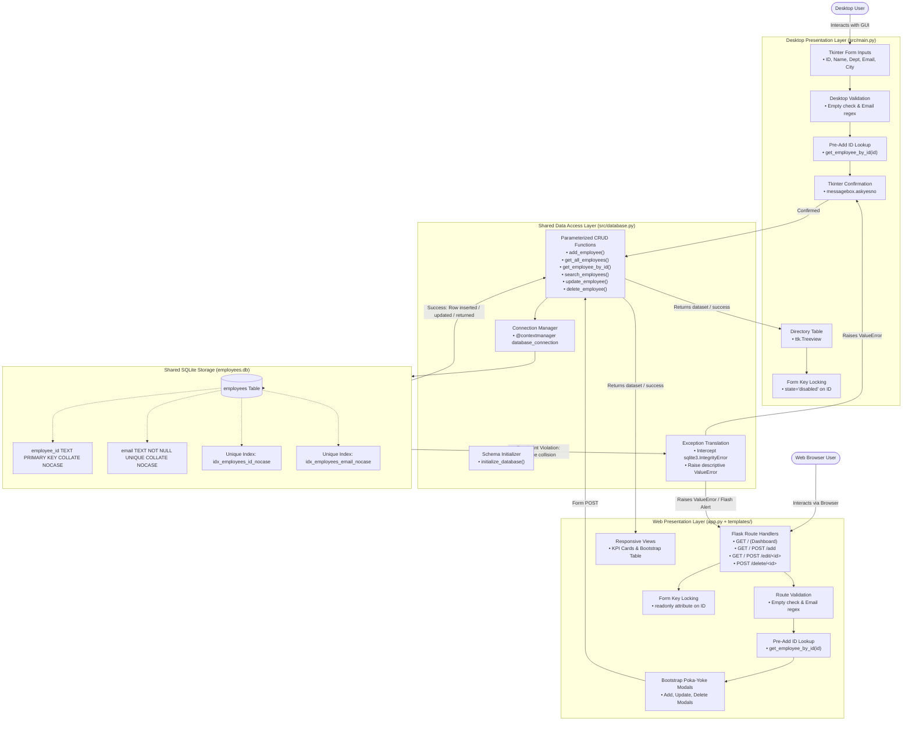

# System Architecture and Flowchart
## Employee Management System — Q06: Reduce Duplicate Entries

- **Course:** BBAT104 — Total Quality Management (TQM)
- **Quality Objective:** Q06 — Reduce Duplicate Entries
- **Author / Student ID:** Riya Mehta (AU-24-5368)
- **Document Version:** 2.0 (Dual-Interface Desktop & Web Architecture)
- **Document Path:** `doc/system-architecture.md`
- **Related Documents:** `doc/srs.md`, `doc/test-report.md`, `doc/defect-and-root-cause.md`, `README.md`

---

## 1. Architectural Overview

The Employee Management System (EMS) is organized as a modular, shared-engine architecture designed for local workstation deployment. The system decouples presentation from data persistence, providing two distinct user interfaces operating concurrently against a single shared backend data layer and SQLite database:

1. **Desktop Presentation Layer (`src/main.py`):**
   * Built using Python's standard `tkinter` and `ttk` desktop GUI widgets.
   * Manages desktop user interactions, form input rendering, table view generation, and modal popup dialogs.
   * Performs client-side validation (non-empty field verification and email regex checking).
   * Implements workflow mistake-proofing (Poka-Yoke), including pre-add ID lookup, selection-based ID locking (`state="disabled"`), and explicit user confirmation prompts (`messagebox.askyesno`).

2. **Web Presentation Layer (`app.py`, `templates/`, `static/`):**
   * Built using `Flask` (v3.1.3+) with Jinja2 HTML templates, custom CSS, and responsive `Bootstrap 5`.
   * Serves an accessible browser interface at `http://127.0.0.1:5000` with real-time KPI metrics (Total Employees, Active Departments).
   * Enforces server-side validation, email regex format checks, and pre-add case-insensitive ID lookups.
   * Implements Poka-Yoke controls including immutable `readonly` Employee ID fields on edit, and Bootstrap confirmation modal popups for additions, updates, and deletions.
   * Protects state modifications by enforcing HTTP `POST` methods for destructive routes (`/delete/<id>`).

3. **Shared Data Access Layer (`src/database.py`):**
   * Encapsulates all relational database logic using Python's built-in `sqlite3` module.
   * Manages SQLite connection lifecycles safely using context managers (`@contextmanager`).
   * Enforces case-insensitive entity uniqueness at the SQLite engine level using `COLLATE NOCASE` constraints and dedicated unique indexes.
   * Translates low-level database engine errors (`sqlite3.IntegrityError`) into actionable domain exceptions (`ValueError`).

4. **Persistent Relational Storage (`employees.db`):**
   * A single local SQLite database file located at the repository root, ensuring that changes made from either interface immediately reflect in the other.

---

## 2. System Architecture Flowchart

The following flowchart illustrates the end-to-end data processing and validation pipeline across both client interfaces, backend data access, and SQLite relational storage:



---

## 3. Duplicate-Prevention Architecture (Quality Goal Q06)

The architecture establishes a multi-tiered defense against duplicate entries, combining interface-level prevention with strict database-level integrity constraints:

```
[ Tier 1: Presentation Layer Poka-Yoke (Desktop & Web) ]
   ├── Mandatory field validation (no empty entries)
   ├── Email format regex validation ([^@\s]+@[^@\s]+\.[^@\s]+)
   ├── Pre-add exact and case-insensitive ID check before confirmation dialog
   ├── Form key locking: Employee ID disabled (Desktop) or readonly (Web) on edit
   └── Explicit confirmation prompts (askyesno / Bootstrap modal) to prevent double submissions
              │
              ▼
[ Tier 2: Database Layer Exception Translation (src/database.py) ]
   ├── Catches raw sqlite3.IntegrityError
   ├── Inspects error text for column names and unique index names
   └── Translates database errors into readable user messages (ValueError)
              │
              ▼
[ Tier 3: SQLite Relational Constraints & B-Tree Indexes (employees.db) ]
   ├── PRIMARY KEY COLLATE NOCASE on employee_id
   ├── UNIQUE COLLATE NOCASE on email
   ├── UNIQUE INDEX idx_employees_id_nocase (backwards compatibility)
   └── UNIQUE INDEX idx_employees_email_nocase (backwards compatibility)
```

### Detailed Mechanism Breakdown

1. **Engine-Level Case-Insensitive Collation:**
   * Declaring `COLLATE NOCASE` informs SQLite's B-tree indexing engine to equate uppercase and lowercase ASCII characters (`'E001' == 'e001'` and `'user@domain.com' == 'USER@DOMAIN.COM'`).
   * This operates transparently on `INSERT`, `UPDATE`, and `SELECT ... WHERE` queries.
2. **Backward-Compatible Index Layer:**
   * SQLite does not automatically alter columns on existing tables when `CREATE TABLE IF NOT EXISTS` is re-run.
   * To protect existing databases, `initialize_database()` executes:
     ```sql
     CREATE UNIQUE INDEX IF NOT EXISTS idx_employees_id_nocase ON employees(employee_id COLLATE NOCASE);
     CREATE UNIQUE INDEX IF NOT EXISTS idx_employees_email_nocase ON employees(email COLLATE NOCASE);
     ```
   * On clean legacy databases, this establishes case-insensitive uniqueness without dropping or recreating tables.
3. **Identifier Immutability on Edit (Form Locking):**
   * **In Desktop (`src/main.py`):** Selecting a row from the Treeview disables the ID text box (`state="disabled"`).
   * **In Web (`app.py` & `templates/edit_employee.html`):** The Employee ID is rendered as `readonly` and styled with a locked badge. Furthermore, the Flask `POST /edit/<employee_id>` handler binds strictly to the URL parameter `<employee_id>`, preventing any modified form body parameter from altering the primary key.

---

## 4. Component Responsibility Matrix

| Architectural Layer | File Path | Core Responsibilities | Duplicate Prevention Role |
| :--- | :--- | :--- | :--- |
| **Desktop Presentation** | `src/main.py` | • Tkinter window layout and widget hierarchy<br>• Entry form inputs and Treeview table<br>• Event binding (`<<TreeviewSelect>>`, `<Return>`)<br>• Modal dialog popups and status messages | • Intercepts blank fields<br>• Validates email format syntax<br>• Pre-checks ID before addition dialog<br>• Locks ID field during update operations<br>• Prompts confirmation dialogs |
| **Web Presentation** | `app.py`<br>`templates/`<br>`static/` | • Flask HTTP routing and request processing<br>• HTML5/Jinja2 template rendering<br>• Responsive Bootstrap 5 UI & KPI cards<br>• Flash notification alerts | • Validates non-empty inputs and email regex<br>• Pre-checks ID before database call<br>• Renders locked readonly ID on edit form<br>• Triggers Bootstrap Poka-Yoke modals<br>• Restricts deletion to POST requests |
| **Data Access Layer** | `src/database.py` | • SQLite connection handling via context manager<br>• Schema initialization (`initialize_database`)<br>• Parameterized SQL queries for CRUD & search<br>• Exception translation (`IntegrityError` $\rightarrow$ `ValueError`) | • Enforces case-insensitive queries (`COLLATE NOCASE`)<br>• Establishes fallback unique indexes<br>• Prevents duplicate emails across different employees on update<br>• Allows self-updates without false collisions |
| **Storage Layer** | `employees.db` | • Local SQLite file-based relational database<br>• Persistent table storage for `employees` | • Enforces primary key uniqueness on `employee_id`<br>• Enforces unique constraint on `email`<br>• Maintains unique B-tree index structures |

---

## 5. Architectural Quality Attributes

* **Modularity:** The Desktop UI (`src/main.py`), Web App (`app.py`), and Database (`src/database.py`) are strictly decoupled. Database functions accept an explicit `db_path`, enabling isolated unit testing without UI dependencies.
* **Robustness:** Database transactions utilize context managers (`with connection:`) ensuring automatic rollback on unexpected exceptions and guaranteed connection closure in `finally` blocks.
* **Performance:** Relational lookups for exact and case-insensitive employee IDs can utilize SQLite B-tree indexes (`SEARCH employees USING INDEX idx_employees_id_nocase`), typically providing $O(\log N)$ lookup complexity. In contrast, multi-column substring filtering via `LIKE '%query%'` (`search_employees`) requires scanning the table sequentially and can take $O(N)$ linear time.

---

## 6. Security and Academic Deployment Boundaries

* **CSRF Token Protection:** Form submissions currently rely on standard HTML forms without CSRF tokens. This design is appropriate for local single-user evaluation and academic demonstrations, but public multi-user deployments require CSRF tokens (e.g., using `Flask-WTF`).
* **Environment Configuration:** The web application defaults to a development secret key when the `SECRET_KEY` environment variable is not defined. Production deployments must provide an entropy-rich secret key via environment variables and set `debug=False`.
